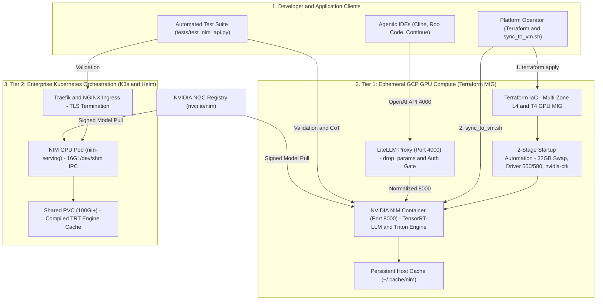

# NVIDIA NIM Enterprise Patterns 🚀

> **Enterprise Reference Architecture** for scalable, secure, cost-effective LLM inference using the NVIDIA AI Enterprise stack (**NVIDIA NIM, TensorRT-LLM, Triton Inference Server, K3s/Kubernetes, Terraform**).

[](https://www.nvidia.com/en-us/ai-data-science/products/nim/)
[](https://github.com/NVIDIA/TensorRT-LLM)
[](https://k3s.io)
[](https://terraform.io)
[](https://cloud.google.com)
[](LICENSE)

---

## 🎯 Why This Architecture Matters — By Stakeholder

### 👔 For Engineering Managers & FinOps Leaders (Business Value & Cost Control)
- **Predictable GPU Economics (60–70% Cloud Savings):** Uses automated **GCP Regional Managed Instance Groups (MIG)** with multi-zone capacity failover and **Spot GPU VMs** for rapid benchmarking, eliminating idle GPU burn and single-zone stockout delays.
- **Data Privacy & Sovereignty:** Runs frontier open-weight reasoning and coding models (**DeepSeek-R1, Meta Llama 3.1**) inside your own VPC or on-premises K3s cluster—zero sensitive source code or enterprise data leaves your security boundary.
- **Sub-30-Second Warm Recovery:** Persistent TensorRT-LLM engine caching reduces container restarts from ~4 minutes (cold download + compilation) to **< 25 seconds**, ensuring high service availability.

### 🏛️ For AI & Cloud Solution Architects (System Design & Engineering Patterns)
- **Two-Tier Hybrid Topology:**
  - **Tier 1 (Rapid Benchmarking & Ephemeral Compute):** Terraform-provisioned GCP GPU VMs (`g2-standard` with NVIDIA L4 24GB or `n1-standard` with T4) with an idempotent two-stage startup script (32GB swap allocation, headless driver 550/580 install, automatic kernel reboot, NVIDIA Container Toolkit, and persistence mode).
  - **Tier 2 (Enterprise K3s / Kubernetes Orchestration):** Declarative Helm values, GPU device plugin integration, shared PVC model caches (`/opt/nim/.cache`), `/dev/shm` memory-backed volumes for TensorRT-LLM IPC, and Traefik/NGINX Ingress.
- **Gateway Normalization for Agentic IDEs:** Documents the **LiteLLM Proxy sidecar pattern (`drop_params: true`)** in front of strict NIM/Triton OpenAI endpoints so autonomous coding agents (**Cline, Roo Code, Continue.dev**) can use Chain-of-Thought `<think>` models without schema rejections.

### 🤝 For Technical Recruiters, HR & Executive Stakeholders (Capabilities Demonstrated)
- **End-to-End AI Infrastructure Engineering:** Demonstrates hands-on mastery across **Cloud IaC (Terraform, GCP Compute/MIG/IAM)**, **GPU Hardware Profiling (CUDA, NVML/`nvidia-smi`, VRAM & TDP optimization)**, **Optimized LLM Serving (NVIDIA NIM, TensorRT-LLM, Triton, Docker, K3s/Helm)**, and **Automated Python API Validation**.

---

## 🎯 Architecture Objectives

This repository bridges **hardware infrastructure provisioning** and **production AI services**:

| Objective | Implementation |
|-----------|----------------|
| **Workload & Resource Sizing** | VRAM/Compute profiling → GPU mapping (L4/T4/H100 ↔ 7B/8B/70B models) |
| **Hybrid Multi-Tier Topologies** | Tier 1: Docker on ephemeral GCP Spot/MIG VMs • Tier 2: K3s on-prem/enterprise |
| **Inference Optimization** | TensorRT-LLM engine compilation, persistent KV/weight caching, `<25s` warm start |
| **Automated MLOps & Governance** | Parameterized Terraform IaC, least-privilege IAM, LiteLLM gateway compatibility, Python test suite |

---

## 🏗️ Deployment & Inference Architecture



---

## 📊 Live Benchmarks (Verified on NVIDIA L4 24GB)

| Metric | Measured Value | Notes |
|--------|----------------|-------|
| **GPU** | 1× NVIDIA L4 (AD104) | 7,424 CUDA / 240 Tensor Cores |
| **Model** | `deepseek-r1-distill-llama-8b` | Reasoning, Chain-of-Thought |
| **VRAM** | 22,081 / 23,034 MiB (95.8%) | Weights + KV Cache |
| **Power** | 33W / 72W (45.8% TDP) | Energy-efficient |
| **Cold Start** | 235 sec | Download + TRT compilation |
| **Warm Restart** | < 25 sec | From host cache |

---

## 🚀 Quick Start

### Prerequisites
- GCP Project with Compute API enabled
- NGC API Key (free: https://build.nvidia.com)
- Terraform ≥ 1.3, gcloud CLI authenticated

### Tier 1: Docker on GCP VM (~5 min)
```bash
# 1. Provision GPU VM
cd iac-scripts/gcp/standalone-nvidia
cp terraform.tfvars.example terraform.tfvars  # Edit with YOUR values
terraform init && terraform apply

# 2. Sync & Run
./scripts/sync_to_vm.sh --docker
gcloud compute ssh <vm-name> --zone=<zone> --command='cd ~/nim_models/docker/deepseek-r1-distill-8b && ./run.sh'
```

### Tier 2: K3s Enterprise (Coming Soon)
```bash
# See nim_models/k3s/README.md for Helm deployment pattern
```

---

## 🧪 Testing & Validation

```bash
# Auto-discover models + run test suite (reasoning, coding, general)
python3 tests/test_nim_api.py --host <VM_IP> --port 8000 --hide-think

# Custom prompt
python3 tests/test_nim_api.py --host <VM_IP> --port 8000 --prompt "Explain quantum entanglement" --hide-think
```

---

## 🏛️ Governance & Security (AI Governance Lab Principles)

- **No secrets in repo**: `.env`, `*.tfstate`, `*.tfvars` → `.gitignore`
- **Parameterized IaC**: All environment-specific values via `tfvars`
- **Least privilege**: Dedicated Compute SA (`roles/logging.logWriter`, `roles/monitoring.metricWriter`)
- **Supply chain**: NGC signed images, cosign verification (planned)
- **Observability**: nvidia-smi persistence, structured startup logs, health endpoints

---

## 📚 Documentation

| Doc | Description |
|-----|-------------|
| `iac-scripts/gcp/config_gcp.md.template` | GCP setup guide (service accounts, ADC, IAM) |
| `nim_models/k3s/README.md` | K3s Helm deployment blueprint |
| `nim_models/docker/.env.example` | Environment template |
| `docs/` | Operational guides (VM connect, nvidia-smi, post-deploy) |

---

## 🗺️ Roadmap

- [ ] NVIDIA GPU Operator integration for K3s
- [ ] Multi-model serving with Triton Model Navigator
- [ ] Prometheus/Grafana dashboards for NIM metrics
- [ ] Cosign image signing + SBOM generation
- [ ] Cost optimization: Spot MIG + preemptible K3s nodes

---

## 👨‍💻 Maintainer & Author

**Marian Ropota** — *Hands-On AI/ML & Cloud Platform Architect | Hybrid Cloud Infrastructure, LLMOps & Agentic Engineering*  
🔗 **[LinkedIn](https://www.linkedin.com/in/marian-rop)** • 🏅 **[Credly Certifications](https://www.credly.com/users/marian-ropota/badges/credly)** • 🐙 **[AI Governance Lab](https://github.com/AI-Governance-Lab)**

*Part of the **AI Governance Lab** open-source engineering portfolio — combining enterprise architecture with hands-on code and automated multi-cloud deployment.*
